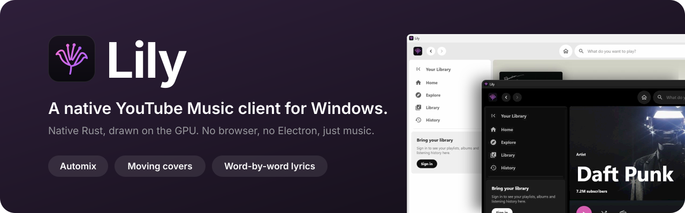
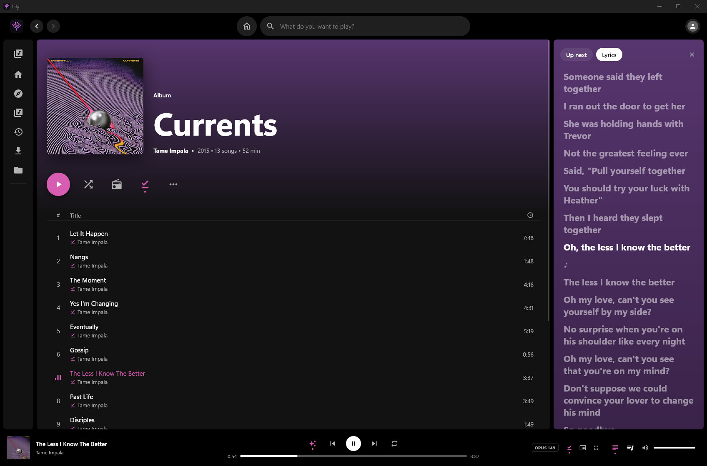
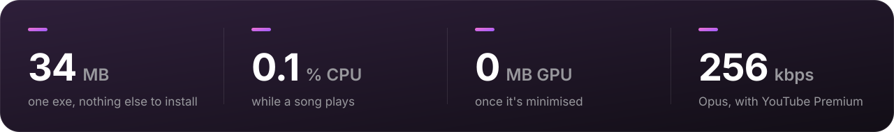
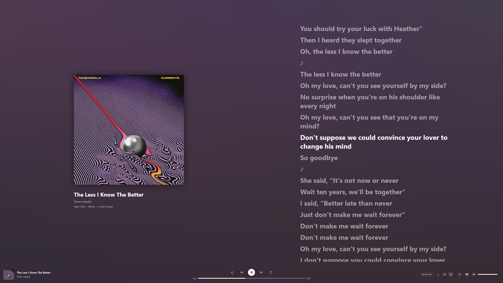
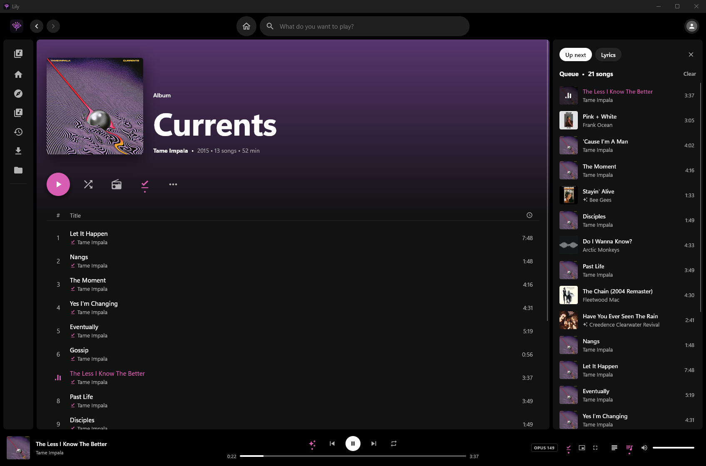
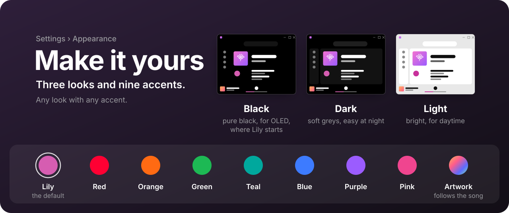

<div align="center">



<br>

[](https://github.com/Visxoz/lily/releases/latest)
[](https://github.com/Visxoz/lily/releases)
[](#install)
[](LICENSE)

<br>

<a href="https://github.com/Visxoz/lily/releases/latest"></a>&nbsp;&nbsp;<a href="https://github.com/Visxoz/Lily-ios"></a>

<br>





<br>

**[Why Lily](#why-lily)** · **[Looks](#make-it-yours)** · **[Install](#install)** · **[Your account](#your-account)** · **[Under the hood](#under-the-hood)**

</div>

## Why Lily

<table>
<tr>
<td width="33%" valign="top">

### Moving covers
Turn on **Animated artwork** in **Settings ▸ Appearance** and the full-screen player plays the album's Apple Music moving cover, or the song's Spotify Canvas once you sign in to Spotify there too.

</td>
<td width="33%" valign="top">

### Lyrics, word by word
Synced lyrics beside the page or full screen, lit up word by word where Apple Music, QQ Music or KuGou time them so. Click a line to jump to it.

</td>
<td width="33%" valign="top">

### Automix
Blends each song into the next like a DJ, over a fade-out or a quiet intro, on the beat when the tempos match. Turn it on, or a plain crossfade, in **Settings ▸ Playback**; otherwise songs follow on gaplessly.

</td>
</tr>
<tr>
<td width="33%" valign="top">

### Sound
256 kbps Opus with Premium, volume levelling, a ten-band equaliser, and crossfeed, mono and balance for headphones.

</td>
<td width="33%" valign="top">

### Takes it offline
Download songs, albums and playlists to play without a connection, and play your own music folders (FLAC, MP3, Opus and more) beside them.

</td>
<td width="33%" valign="top">

### Native
A single exe in Rust, drawn by the GPU, with a mini player that stays on top. It reopens on the song you left, at the second you left it, and minimised gets by on about 34 MB of RAM.

</td>
</tr>
</table>



<table>
<tr>
<td width="50%"></td>
<td width="50%"></td>
</tr>
</table>

## Make it yours



## Install

Grab one from the [latest release](https://github.com/Visxoz/lily/releases/latest):

- **Installer**, `lily_<version>_x64-setup.exe`: installs for your account only, with no admin prompt.
- **Portable**, `lily_<version>_x64-portable.exe`: put it anywhere and run it.

Both keep themselves up to date, checking each download against the release's SHA-256 checksums.

> [!NOTE]
> The app isn't code-signed yet, so SmartScreen may say it "protected your PC": choose **More info**, then **Run anyway**. If Smart App Control blocks it, right-click the file, choose **Properties**, tick **Unblock**, and run it again.

> [!WARNING]
> Lily is an unofficial client. It uses YouTube's undocumented API, which is against YouTube's terms of service. Google could ask you to confirm you're not a bot or sign the session out, and could in principle restrict the account. A separate account is the safest choice.

## Your account

Lily works signed out. Choose **Sign in** in the sidebar, then **Sign in with Google**, and sign in on Google's own page. Home, Library and history become yours, and you can save albums and playlists, subscribe to artists, edit your own playlists, and pin any of them to the top of the sidebar. What you play counts towards your YouTube history unless you turn off **YouTube history** in **Settings ▸ Account**. The sign-in is kept encrypted for your Windows account only. Signing in uses Microsoft Edge WebView2, which comes with Windows 11 and most Windows 10 PCs.

Discord's status and Last.fm scrobbling are in **Settings ▸ Account** too.

## Under the hood

Everything you see and hear is native code, written in Rust. A browser engine appears only to show Google's or Spotify's sign-in page, and, out of sight, for the lyrics hub's Cloudflare check.

<details>
<summary><b>How it works</b></summary>
<br>


Most YouTube clients get stream URLs that YouTube's player JavaScript has to unscramble. The visionOS client gets plain ones, so the app asks as that client and needs no JavaScript engine, falling back to Android VR and iOS if YouTube changes it. With Premium, the app unscrambles the web player's URLs itself, in a short-lived QuickJS context with a cut-down copy of the player.

The app talks only to YouTube's hosts, checked against an allowlist, plus GitHub for updates, Apple Music's and Spotify's for moving covers, Better Lyrics' hub, lrc.red, LRCLIB and KuGou (Tencent Music, in China) for lyrics (sent a song's title, artist and length while lyrics are open, and the hub its video ID too; KuGou only when the others have no word timing), and Last.fm if you connect it.

It follows a proxy set by hand in Windows' settings, or one of your own in **Settings ▸ About**, used from Lily's next start, and keeps everything in `%APPDATA%\Lily`.

</details>

<details>
<summary><b>Building from source</b></summary>
<br>

You need Rust with the MSVC toolchain. Three crates are built from `vendor/` with a patch from `patches/` applied, so vendor them once after cloning, and again after updating Slint or rustypipe:

```powershell
./scripts/vendor-patched.ps1
```

```powershell
cargo run              # debug build with logging
cargo build --release  # target/release/lily.exe
cargo test
```

Every release is built by [GitHub Actions](.github/workflows/release.yml), never on anyone's computer. To check a download (0.1.13 or later) came from there, run `gh attestation verify <exe> --repo Visxoz/lily`.

</details>

## Licence

Lily is free software under the [GNU General Public License, version 3](LICENSE). It builds on [rustypipe](https://codeberg.org/ThetaDev/rustypipe), which is GPL-3.0, and on [Slint](https://slint.dev) under its GPL-3.0 option.

Lyrics come partly from [Better Lyrics](https://github.com/better-lyrics/better-lyrics)' lyrics hub. Thanks to Better Lyrics for it.

<br>

<div align="center">
<sub>Not affiliated with, endorsed by or connected to YouTube or Google. YouTube Music is a trademark of Google LLC.</sub>
</div>
