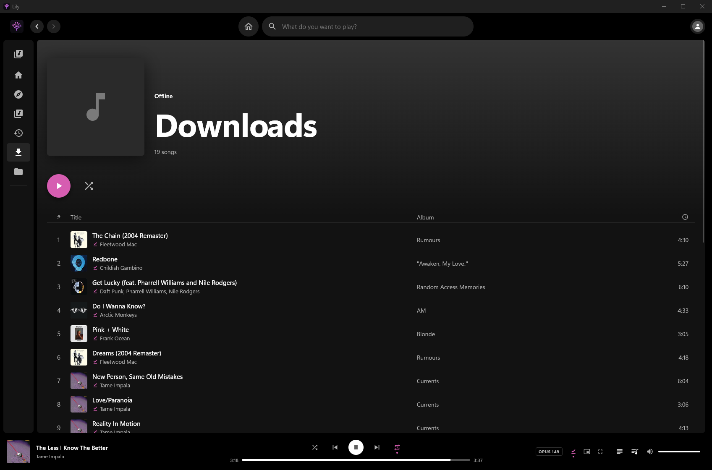
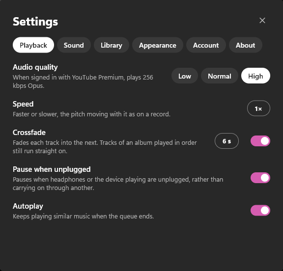
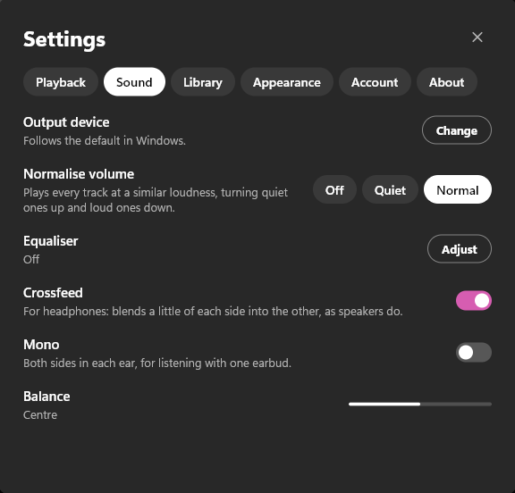
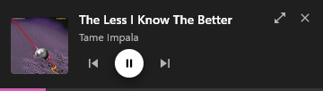
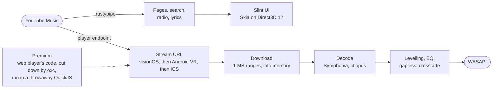

<div align="center">


Your YouTube Music account on the Windows desktop: Home, playlists, likes and history, with downloads for offline, your own music files, a mini player, Last.fm scrobbling and your song on Discord.

<br>

[](https://github.com/Visxoz/lily/releases/latest)
[](https://github.com/Visxoz/lily/releases)
[](https://github.com/Visxoz/lily/actions/workflows/ci.yml)
[](#install)
[](#under-the-hood)
[](LICENSE)

<br>

<a href="https://github.com/Visxoz/lily/releases/latest"></a>&nbsp;&nbsp;<a href="https://github.com/Visxoz/Lily-ios"></a>

<br>


<sub>Dark look · pages and lyrics tinted from the artwork</sub>

<br><br>


<br>

**[Why Lily](#why-lily)** · **[Full screen](#full-screen)** · **[Offline](#take-it-offline)** · **[Looks](#make-it-yours)** · **[Sound](#sounds-as-good-as-youtube-gets)** · **[Lightweight](#light-enough-to-forget-about)** · **[Install](#install)** · **[Your account](#your-account)** · **[Under the hood](#under-the-hood)**

</div>

## Why Lily

<table>
<tr>
<td width="33%" valign="top">

### Sounds better
256 kbps Opus with Premium, gapless playback, a crossfade of your chosen length or Automix's DJ-style blends, volume levelling, a ten-band equaliser, and crossfeed, mono and balance for headphones.

</td>
<td width="33%" valign="top">

### Weighs nothing
A single exe, drawn by the GPU, using 0.1% of the CPU while it plays. Minimised, it hands back its GPU memory and gets by on about 34 MB of RAM.

</td>
<td width="33%" valign="top">

### Looks the part
Pure black and orchid out of the box, or dark or light, in eight other accents including one that follows the song's artwork. Pages are tinted to match.

</td>
</tr>
<tr>
<td width="33%" valign="top">

### All of YouTube Music
Your Home feed, Explore, radio, autoplay, Smart Shuffle, repeat, history and search with recent searches. Artist pages carry the whole discography.

</td>
<td width="33%" valign="top">

### Lyrics and queue
Synced lyrics you can click to jump to, beside the page or full screen. A queue you drag into order, edit several songs at a time, and save as a playlist.

</td>
<td width="33%" valign="top">

### Your library
Your playlists in the sidebar, pinned how you like. Reorder, rename and share your own, save albums and playlists, and subscribe to artists.

</td>
</tr>
<tr>
<td width="33%" valign="top">

### Offline too
Download songs, albums and playlists to play without a connection, and play your own music folders (FLAC, MP3, Opus and more) beside them.

</td>
<td width="33%" valign="top">

### Stays out of the way
A mini player that floats on top, and close to the tray to keep the music going. Reopens on the song you left, at the second you left it.

</td>
<td width="33%" valign="top">

### At home on Windows
Media keys and the Windows media overlay, Discord and Last.fm, the output device of your choice, and pausing when you unplug your headphones.

</td>
</tr>
</table>

## Full screen


The full-screen button in the player bar puts the artwork and its lyrics over the artwork's own colours, with the queue a click away in a drawer. Turn on Animated artwork in Settings and, where there is one, the artwork moves: the album's Apple Music motion cover, or the song's Spotify Canvas once you sign in to Spotify there too. <kbd>Esc</kbd> leaves.

## Smart Shuffle and the queue


Press shuffle twice for Smart Shuffle, and Lily slips a song you might like in after every three or four of your own, marked with a sparkle. Turn it off and they're taken out again. Drag the queue into order, pick several songs with <kbd>Ctrl</kbd>- and <kbd>Shift</kbd>-click to play next or remove together, and, signed in, save the lot as a playlist.

## Take it offline



Download a song, an album or a playlist from its menu or its header, and from then on it plays from the file wherever it appears, with Downloads keeping them together. Add your own music folders in **Settings ▸ Library** and they play from **Local files**, in FLAC, MP3, Opus and more.

## Make it yours

<table>
<tr>
<td width="50%"></td>
<td width="50%"></td>
</tr>
<tr>
<td align="center"><b>Dark</b> · artist pages with the queue beside them</td>
<td align="center"><b>Light</b> · album pages tinted from the cover</td>
</tr>
<tr>
<td width="50%"></td>
<td width="50%"></td>
</tr>
<tr>
<td align="center"><b>Home</b> · tinted with your accent</td>
<td align="center"><b>Explore</b> · moods, genres and new releases</td>
</tr>
</table>

Lily starts in pure black with its own orchid. Pick another look and accent in **Settings ▸ Appearance**: Lily, Red, Orange, Green, Teal, Blue, Purple, Pink, or **From the artwork**.

## Sounds as good as YouTube gets

<table>
<tr>
<td width="50%"></td>
<td width="50%"></td>
</tr>
<tr>
<td width="50%"></td>
<td width="50%"></td>
</tr>
</table>

| Feature | What it does |
| --- | --- |
| **Premium streams** | Signed in with Premium on High, songs play in YouTube's 256 kbps formats, and the player bar says so. Music videos swap to their song versions to get them. |
| **Gapless** | The next song is lined up 15 seconds early and follows without a gap, and the screen changes the moment the sound does. |
| **Crossfade** | Fades each song into the next over 1 to 12 seconds (6 by default), cutting the silence at the joins. An album played in order still runs straight on, and skipping never fades. |
| **Automix** | In place of the crossfade, blends each song into the next like a DJ: over a fade-out or a quiet intro, on the beat when the tempos match, one bass line at a time. An album played in order still runs straight on. |
| **Equaliser** | Ten bands from 31 Hz to 16 kHz, ±12 dB each, with presets: Flat, Bass boost, Treble boost, Vocal, Rock, Electronic and Acoustic. Boosting turns the rest down to leave headroom. |
| **Normalise volume** | Plays every track at a similar loudness, from YouTube's own measurement: loud ones turned down and quiet ones up, at Normal or a Quiet level 6 dB lower, with a limiter so nothing clips. |
| **For headphones** | Crossfeed blends a little of each side into the other, as speakers do. Mono is there for one earbud, and a balance slider for everything else. |
| **Speed** | From 0.8× to 1.3×, like a record: the pitch moves with it. |
| **No clicks, no drop-outs** | Pausing ramps the sound down, and seeks and skips fade in. Unplug your headphones and the music pauses, or with **Pause when unplugged** off, carries on through the next device. |

## Light enough to forget about


When you minimise it, the app throws away its GPU surface and drawing caches, and builds them again the moment you bring it back. Pause the music and the audio device stops too, so the app sleeps and Windows can as well.

<p align="center"></p>

Closing the window leaves the music playing from the system tray (unless you turn **Close to the system tray** off), and the tray's menu has the controls. The mini player, from the player bar or the tray, is a small window with the artwork and controls that stays on top of the others; double-click it to bring Lily back.

<details>
<summary><b>How these were measured</b></summary>
<br>

The 0.1.19 release on Windows 11 (16 logical processors), signed in with Premium, sampled with Windows' own performance counters after each state had settled. The minimised figures were taken five minutes in, as memory keeps falling for the first few minutes.

| State | RAM (Task Manager) | Committed | GPU memory | CPU | CPU, one core |
| --- | ---: | ---: | ---: | ---: | ---: |
| Home open, nothing playing | 75 MB | 222 MB | 125 MB | 0% | 0.05% |
| Playing, window open | 91 MB | 239 MB | 125 MB | 0.13% | 2.0% |
| Playing, minimised | 34 MB | 40 MB | 0 MB | 0.03% | 0.5% |
| Paused, minimised | 33 MB | 39 MB | 0 MB | 0.01% | 0.2% |

RAM is the private working set, the figure Task Manager's Memory column shows. Committed is private bytes. GPU memory is dedicated video memory.

</details>

## Install

Grab one from the [latest release](https://github.com/Visxoz/lily/releases/latest):

<table>
<tr>
<td width="50%" valign="top">

**Installer** · `lily_<version>_x64-setup.exe`

Installs for your account only, with no admin prompt, a Start menu entry and an uninstaller.

</td>
<td width="50%" valign="top">

**Portable** · `lily_<version>_x64-portable.exe`

Put it anywhere and run it. Nothing is installed.

</td>
</tr>
</table>

Both keep themselves up to date. When a new version is out, a card above the player bar offers it and a dot appears on the account button; **Settings ▸ About ▸ Updates** installs it too, and restarts. Every download is checked against the release's SHA-256 checksums first.

> [!NOTE]
> The app isn't code-signed yet, so SmartScreen may say it "protected your PC": choose **More info**, then **Run anyway**. If Smart App Control blocks it, right-click the file, choose **Properties**, tick **Unblock**, and run it again.

## Your account

Lily works without an account. Sign in and it becomes your YouTube Music: your playlists and Liked music in the sidebar, your albums and artists in Library, your own feed on Home, and what you play here counting towards your history and recommendations.

To sign in, choose **Sign in** in the sidebar (or in **Settings ▸ Account**), then **Sign in with Google**, and sign in on Google's own page. The window closes by itself once you're in.

| Signed in, you can | How |
| --- | --- |
| **Pin playlists** | Right-click one in the sidebar and choose **Pin to top**. |
| **Edit your own playlists** | Drag songs into a new order or remove them on the playlist's page, and rename, share or delete it from the header's menu. Making one public or unlisted needs a YouTube channel on the account. |
| **Save and subscribe** | Save any other album or playlist to your library from its header, and subscribe to artists. |
| **Rate songs** | Like and dislike with the thumbs beside the playing song, or from a song's menu. |
| **Keep plays to yourself** | Turn off **YouTube history** in **Settings ▸ Account**, and what you play here stays out of your account's history. |

Discord's status and Last.fm scrobbling don't need an account; both are in **Settings ▸ Account** too.

The sign-in is stored encrypted for your Windows account only, with DPAPI. Signing in uses Microsoft Edge WebView2, which comes with Windows 11 and most Windows 10 PCs.

<details>
<summary><b>Prefer pasting cookies?</b></summary>
<br>

Open music.youtube.com in a private browser window and sign in. Copy either a cookies.txt export or the `Cookie` request header from the developer tools (Network tab). In Lily's sign-in window, choose **Paste cookies instead**, paste them, choose **Sign in with cookies**, and close the private window. YouTube rotates the cookies of sessions that stay open.

</details>

> [!WARNING]
> Lily is an unofficial client. It uses YouTube's undocumented API, which is against YouTube's terms of service. Google could ask you to confirm you're not a bot or sign the session out, and could in principle restrict the account. A separate account is the safest choice.

## Shortcuts

| Keys | Does |
| --- | --- |
| <kbd>Space</kbd> | Play or pause |
| <kbd>Ctrl</kbd> <kbd>←</kbd> / <kbd>Ctrl</kbd> <kbd>→</kbd> | Previous or next song |
| <kbd>Ctrl</kbd> <kbd>K</kbd> | Search (<kbd>Ctrl</kbd> <kbd>F</kbd> and <kbd>Ctrl</kbd> <kbd>L</kbd> work too) |
| <kbd>Ctrl</kbd> <kbd>B</kbd> | Collapse or expand the library sidebar |
| <kbd>Alt</kbd> <kbd>←</kbd> / <kbd>Alt</kbd> <kbd>→</kbd> | Back or forward |
| <kbd>Delete</kbd> | Remove the songs picked in the queue |
| <kbd>Esc</kbd> | Close a dialog or search, clear the queue's selection, or leave full screen |

Right-click a song to play it next, add it to the queue, start a radio, download it, or go to its artist or album, and signed in, to like it or save it to a playlist. **Copy link** is in the menus of songs, the queue, cards, page headers, the player bar and the sidebar's playlists. In the queue, <kbd>Ctrl</kbd>-click and <kbd>Shift</kbd>-click pick several songs at once. The mouse wheel moves the seek bar and volume.

## Also on iPhone

<a href="https://github.com/Visxoz/Lily-ios"></a>

[Lily for iPhone](https://github.com/Visxoz/Lily-ios) is Lily built again in Swift and SwiftUI, on Apple's own audio engine, with the same orchid look, Premium streams, gapless playback, crossfade, equaliser and synced lyrics. It adds the lock screen and Control Center, your AirPods and a Liquid Glass tab bar. Add it to AltStore, SideStore or Feather for updates as they come, or grab it from its [releases](https://github.com/Visxoz/Lily-ios/releases/latest).

## Under the hood

Everything you see and hear is native code, written in Rust. A browser engine only appears while you sign in, to show Google's page.



<details>
<summary><b>What it's built with</b></summary>
<br>

| Part | Built with |
| --- | --- |
| YouTube Music data | [rustypipe](https://codeberg.org/ThetaDev/rustypipe) |
| Stream URLs | YouTube's player endpoint, called directly (`src/streams`) |
| Premium URLs | [oxc](https://oxc.rs) and [QuickJS](https://github.com/DelSkayn/rquickjs) |
| Demuxing and AAC | [Symphonia](https://github.com/pdeljanov/Symphonia) |
| Opus | libopus 1.3.1, as Rust ([unsafe-libopus](https://crates.io/crates/unsafe-libopus)) |
| Audio output | [cpal](https://github.com/RustAudio/cpal), through WASAPI |
| Interface | [Slint](https://slint.dev), drawn by Skia on the GPU through Direct3D 12 |
| Networking | reqwest over Windows Schannel and HTTP/2, on Tokio |
| Google sign-in | WebView2 through [wry](https://github.com/tauri-apps/wry), only while signing in |
| Media keys | [souvlaki](https://github.com/Sinono3/souvlaki) |

Most YouTube clients get stream URLs that YouTube's player JavaScript has to unscramble. The visionOS client gets plain ones, so the app asks as that client and needs no JavaScript engine, falling back to Android VR and iOS if YouTube changes it. A daily check flags it when one of them stops working. With Premium, the app unscrambles the web player's URLs itself, in a short-lived QuickJS context with a cut-down copy of the player.

The app talks to YouTube's hosts, checked against an allowlist, plus GitHub for updates and Last.fm if you connect it. It follows a proxy set by hand in Windows' settings, or one of your own in **Settings ▸ About**. It keeps everything in `%APPDATA%\Lily`, and moves the folder of versions named ytm-native there on its first start.

</details>

<details>
<summary><b>Building from source</b></summary>
<br>

You need Rust with the MSVC toolchain. Three crates are built from `vendor/` with a patch from `patches/` applied, so vendor them once after cloning, and again after updating Slint or rustypipe:

```powershell
./scripts/vendor-patched.ps1
```

```powershell
cargo run              # debug build with logging
cargo build --release  # target/release/lily.exe
cargo test
```

The patches:

- `i-slint-common` memory-maps the fallback fonts instead of reading them into the heap.
- `i-slint-renderer-skia` drops its GPU surface and caches while the window is minimised, and asks wgpu for far fewer bindings, about 30 MB less memory while the window shows.
- `rustypipe` opens the signed-in user's own playlists and mixes, reads what editing and the library need (whether a playlist is yours, whether an album or playlist is saved, whether you're subscribed to an artist), takes in the fresh cookies YouTube sends, notices a session that has ended, fetches visitor IDs from YouTube's API rather than the Music home page, and retries or backs off when YouTube refuses requests.

Release builds write warnings, errors and crashes to `%APPDATA%\Lily\lily.log`, with every URL cut down to its host; `YTM_LOG=info` (or `debug`) logs more. A request that crashes fails on its own rather than closing the app.

</details>

## Licence

Lily is free software under the [GNU General Public License, version 3](LICENSE). It builds on [rustypipe](https://codeberg.org/ThetaDev/rustypipe), which is GPL-3.0, and on [Slint](https://slint.dev) under its GPL-3.0 option.

<br>

<div align="center">
<sub>Not affiliated with, endorsed by or connected to YouTube or Google. YouTube Music is a trademark of Google LLC.</sub>
</div>
